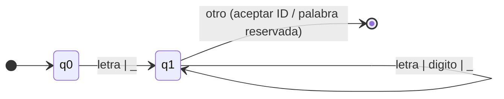
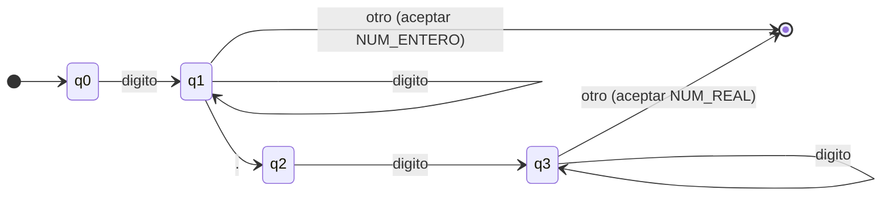

# Autómata finito: identificadores y números

**Responsable:** Persona 1

<!-- TODO(P1): completar el diagrama y la tabla de transiciones.
     GitHub dibuja los bloques mermaid automáticamente. También se puede
     exportar como imagen a docs/img/ para el video. -->

## Identificadores

## Números

## Tabla de transiciones

<!-- TODO(P1) -->

| Estado | letra / `_` | dígito | `.` | otro | ¿Acepta? |
| --- | --- | --- | --- | --- | --- |
| q0 | | | | | |
| q1 | | | | | |
| q2 | | | | | |
| q3 | | | | | |

## Relación con el código

Cada estado inicial corresponde a un método de `compiler/lexer.py`:
`read_identifier` y `read_number`.
