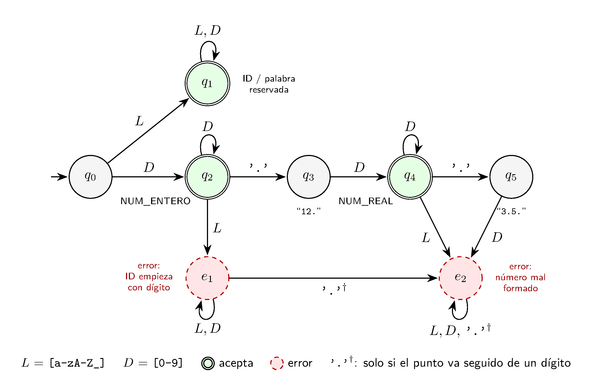
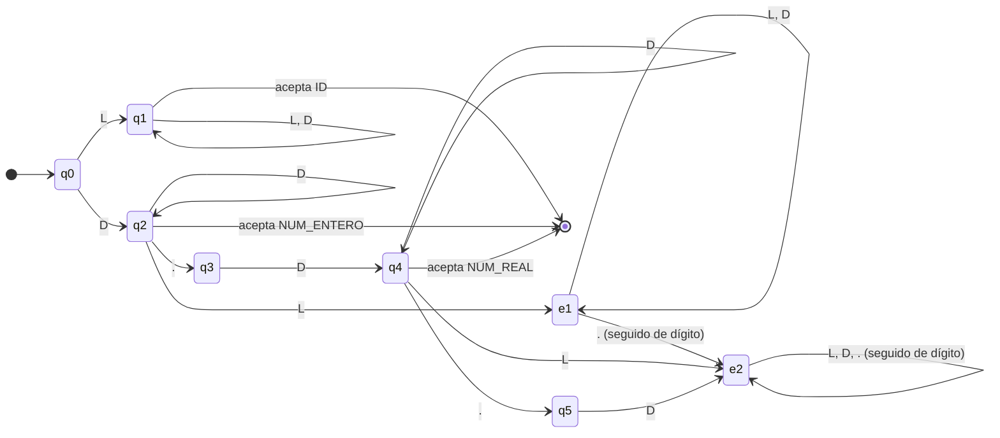

# Autómata finito: identificadores y números

**Responsable:** Persona 1

Versión completa, con la definición formal, el teorema de Kleene y las referencias:
[latex/automata.pdf](latex/automata.pdf) (fuente: [latex/automata.tex](latex/automata.tex)).
Imagen para el video: [img/automata.png](img/automata.png).



## Clases de caracteres

| Clase | Caracteres |
| --- | --- |
| `L` | letras ASCII y `_`: `[a-zA-Z_]` |
| `D` | dígitos: `[0-9]` |
| `.` | el punto |
| `O` | cualquier otro carácter de Σ (espacios, operadores, delimitadores) |

## Definición formal

M = (Q, Σ, δ, q0, F), con:

- Q = { q0, q1, q2, q3, q4, q5, e1, e2 }
- F = { q1, q2, q4 }

| Estado | Significado |
| --- | --- |
| q0 | inicio |
| q1 | ID o palabra reservada (acepta) |
| q2 | NUM_ENTERO (acepta) |
| q3 | leyó `dígitos.` y espera un dígito |
| q4 | NUM_REAL (acepta) |
| q5 | leyó `real.` y espera un dígito |
| e1 | error: identificador que empieza con dígito (`3abc`) |
| e2 | error: número mal formado (`12.3.4`, `3.5x`) |

## Diagrama (mermaid)

Versión simplificada para verlo en GitHub. La versión cuidada es la imagen de arriba.



## Tabla de transiciones

`—` significa que no hay transición: el lexema termina y se ejecuta la acción de la
última columna.

| Estado | `L` | `D` | `.` | `O` | Al terminar el lexema |
| --- | --- | --- | --- | --- | --- |
| → q0 | q1 | q2 | — | — | (no es identificador ni número) |
| \* q1 | q1 | q1 | — | — | acepta ID o palabra reservada |
| \* q2 | e1 | q2 | q3 | — | acepta NUM_ENTERO |
| q3 | — | q4 | — | — | error: número mal formado (`12.`) |
| \* q4 | e2 | q4 | q5 | — | acepta NUM_REAL |
| q5 | — | e2 | — | — | retrocede a q4: emite NUM_REAL y vuelve a leer el `.` |
| e1 | e1 | e1 | e2 † | — | error: identificador empieza con dígito |
| e2 | e2 | e2 | e2 † | — | error: número mal formado |

→ estado inicial · \* estado de aceptación · † solo si el punto va seguido de un dígito
(un carácter de anticipación)

Notas:

- **δ es parcial.** Para tener un AFD completo basta agregar un estado sumidero que
  reciba todas las celdas vacías; el lenguaje aceptado no cambia.
- **Los estados de error no están en F.** No cambian el lenguaje aceptado. Su función es
  consumir el lexema mal formado completo para reportar un solo error.
- **q5 modela el retroceso.** En `3.5.x` el lexer emite `3.5` y vuelve a analizar desde
  el segundo punto. En `12.` el equipo decidió no retroceder y reportar el error.

## Trazas

| Entrada | Recorrido | Resultado |
| --- | --- | --- |
| `x_1` | q0 →x q1 →_ q1 →1 q1 | ID |
| `3.14` | q0 →3 q2 →. q3 →1 q4 →4 q4 | NUM_REAL |
| `12.` | q0 →1 q2 →2 q2 →. q3 | error: termina en q3 ∉ F |
| `3abc` | q0 →3 q2 →a e1 →b e1 →c e1 | error: ID empieza con dígito |
| `12.3.4` | … q3 →3 q4 →. q5 →4 e2 | error: número mal formado |

## Por qué es un lenguaje regular

Por el **teorema de Kleene** (1956), un lenguaje es aceptado por un autómata finito si y
solo si se describe con una expresión regular. Si se eliminan estados de M se obtienen
justamente las expresiones regulares de [especificacion_tokens.md](especificacion_tokens.md):

- q1: `L (L | D)*` → ID
- q2: `D+` → NUM_ENTERO
- q4: `D+ . D+` → NUM_REAL

La demostración y las referencias (Kleene; Rabin y Scott; McNaughton y Yamada; Thompson;
Hopcroft, Motwani y Ullman; Sipser; Aho y otros) están en
[latex/automata.pdf](latex/automata.pdf).

## Relación con el código

| Autómata | `compiler/lexer.py` |
| --- | --- |
| q0 → q1 y el lazo de q1 | `read_identifier()` |
| q0 → q2 … q5, e1, e2 | `read_number()` |
| Anticipación † | `self.current() == "." and is_digit(self.peek())` |
| Palabra reservada en q1 | `KEYWORDS.get(lexeme, TokenType.ID)` |

## Compilar el LaTeX

```bash
cd docs/latex
latexmk -pdf automata.tex          # documento completo
pdflatex automata_figura.tex       # solo la figura
```

`automata_diagrama.tex` contiene el diagrama TikZ y lo usan los dos archivos.
